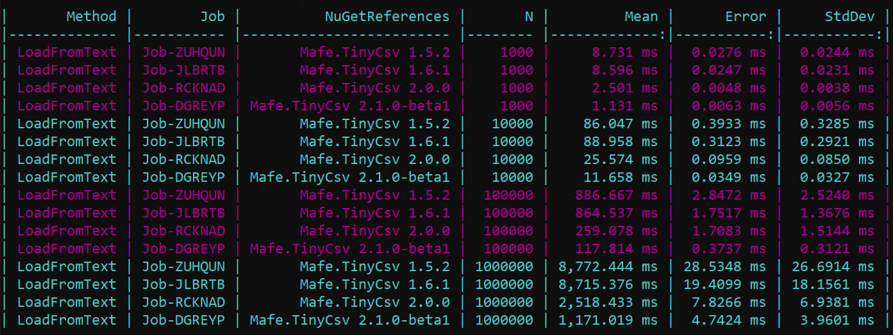

# TinyCsv

TinyCsv is a .NET library to read and write CSV data in an easy way.

To use it in your project, add the Mafe.TinyCsv NuGet package to your project.

[](https://www.nuget.org/packages/Mafe.TinyCsv/3.3.0)


It is available an AspNetCore extension:

[](https://www.nuget.org/packages/Mafe.TinyCsv.AspNetCore/2.4.0)


Define the model that you want to use, like this:

```c#
public class Model
{
    public int Id { get; set; }
    public string Name { get; set; }
    public decimal Price { get; set; }
    public DateTime CreatedOn { get; set; }
    public string TextBase64 { get; set; }
}
```

Now, it is necessary to define the TinyCSV options, like this:

```c#
var csv = new TinyCsv<Model>(options =>
{
    // Options
    options.HasHeaderRecord = true;
    options.Delimiter = ";";
    options.RowsToSkip = 0;
    options.SkipRow = (row, idx) => string.IsNullOrWhiteSpace(row) || row.StartsWith("#");
    options.TrimData = true;
    options.AllowRowEnclosedInDoubleQuotesValues = true;
    options.EnableHandlers = false;
    options.ValidateColumnCount = true;

    // Columns
    options.Columns.AddColumn(m => m.Id);
    options.Columns.AddColumn(m => m.Name);
    options.Columns.AddColumn(m => m.Price);
    options.Columns.AddColumn(m => m.CreatedOn, "dd/MM/yyyy");
    options.Columns.AddColumn(m => m.TextBase64, new Base64Converter());
});
```

The options defines that the file has the header in first row and the delimier char is ";", furthermore there are defined some columns.
RowsToSkip and SkipRow are used to skip the first rows of the file.
When `SkipRow` is not set and the handlers are not enabled, the records are read without creating a string for each record, so the read is faster and allocates less memory.
TrimData is used to remove the white spaces from the data.

The rows starting with the `Comment` char (`#` by default) are skipped when `AllowComment` is true (default),
while `AllowComment = false` throws a `NotAllowCommentException`.
The `TextEncoding` option (UTF-8 by default) is used to read and write files, streams and text; a byte order mark, if present, takes precedence while reading.

## Culture

The `Culture` option is used to read and write numbers, dates and the columns with a format.
The default is `CultureInfo.InvariantCulture`, so a file is written and read in the same way on every machine:

```c#
var csv = new TinyCsv<Model>(options =>
{
    options.Culture = new CultureInfo("it-IT"); // 1234,5 and 02/11/2026
    // ...
});
```

With attributes, use `[Culture("it-IT")]` on the model.
A column with its own format provider (`AddColumn(..., IFormatProvider)` or `[Column(formatProvider: ...)]`) uses that provider.

## Quoted values and multi-line records

TinyCsv follows [RFC 4180](https://www.rfc-editor.org/rfc/rfc4180):

- a value is quoted (`"..."`) when it contains the delimiter, a quote or a new line;
- a quote inside a quoted value is escaped by doubling it (`""`);
- a quoted value can span multiple lines: the whole record is **one row**, for `RowsToSkip`, `SkipRow`, the events and `GetAllLines*`.

```csv
Id;Name;Note
1;"Rossi; Mario";"He said ""hello"""
2;Luigi;"first line
second line"
```

The file above contains 2 rows. `Save` escapes the values in the same way, so a saved file is always read back as it is.

## Breaking changes in 3.0

TinyCsv 3.0 has a new reader, based on `Span<char>`, that reads a CSV record instead of a physical line.
It is faster and allocates less memory, and it fixes the parsing of quoted values.
Some behaviours changed, please check them when you upgrade from 2.x:

| Area | 2.x | 3.0 |
|---|---|---|
| Quoted value on multiple lines | split in two broken rows | one row, the new lines are kept in the value |
| Doubled quotes `""` in a quoted value | not always unescaped (`"";x` was read as `;x`) | unescaped to `"` |
| Quote in the middle of an unquoted value (`5" pipe`) | removed | kept |
| `"` and `'` at the start/end of a value | always removed | only the enclosing quotes of a quoted value are removed |
| `TrimData` on a quoted value | trimmed inside the quotes | the spaces inside the quotes are kept |
| Rows starting with `#` (the `Comment` char) with `AllowComment = true` | read as data | skipped. Change `Comment` if your data starts with `#` |
| `EndOfLineDelimiterChar = false` | the last value of the row was lost | the last value is read, a trailing delimiter throws |
| Empty last value (`1;Mario;` with 3 columns) | `null` | empty string |
| Empty line without `SkipRow` | `IndexOutOfRangeException` | a model with default values |
| `SkipRow` index with `RowsToSkip` | inconsistent (and different between sync and async) | the record index, starting from 0 |
| `GetAllLinesAndFields*` | always empty arrays | the values of each row |
| `Save`/`GetAllText` of values with quotes or new lines | not escaped, the file could not be read back | escaped as RFC 4180 (with `AllowBackSlashToEscapeQuote`, quotes and backslashes are escaped with `\`) |
| `TextEncoding` | ignored while reading | used to read and write |
| `[TextEncoding]` attribute | could not be used as attribute | `[TextEncoding("utf-16")]` or `[TextEncoding(1200)]` |
| `DoubleQuotes` option | ignored | used as quote char |
| `LoadFromFile`, `Save` and the other methods with a path | the file was not closed | the file is closed |
| `[Column(name: "...")]` | `KeyNotFoundException` | the name is used for the header, the value is mapped to the property |
| Nullable enum properties | `ArgumentException` | supported |
| Unknown enum value | `null` | the default enum value |
| `ToListAsync()` on .NET 10 | ambiguous with `System.Linq.AsyncEnumerable.ToListAsync` | TinyCsv's extension is not defined on .NET 10, the BCL one is used |

Furthermore:

- added the `net10.0` target;
- `netstandard2.0` and `net462`-`net48` depend on `System.Memory`.

### Renamed in 3.1.0

Two names with a typo have a new name.
The old names still work, but they are obsolete (warning `CS0618`) and they will be removed in 4.0:

| Obsolete | New |
|---|---|
| `GetAlGetAllLinesAndFieldslLinesFromText` | `GetAllLinesAndFieldsFromText` |
| `Handlers.Write.RowWrittin` (`RowWrittinEventArgs<T>`) | `Handlers.Write.RowWritten` (`RowWrittenEventArgs<T>`) |

3.1.0 replaces 3.0.0, which has been unlisted from NuGet.

### Changes in 3.1

3.1 adds `MapColumnsByHeader`, the automatic columns and the `Culture` option.
The `Culture` option fixes how the values are read, please check them when you upgrade:

| Area | 3.0 | 3.1 |
|---|---|---|
| Dates and times without a format (`DateTime`, `DateTimeOffset`, `DateOnly`, `TimeOnly`, `TimeSpan`) | written with the invariant culture, read with the culture of the machine: on a non US machine a saved file was not read back as it is (`11/02/2026` was read as 11 February) | written and read with `Culture` |
| Columns with a format (i.e. `"dd MMMM yyyy"`, `"N2"`) | written and read with the culture of the machine | written and read with `Culture` |
| `byte` and `sbyte` | written and read with the culture of the machine | written and read with `Culture` |

To read the values with the culture of the machine, as in 3.0, set `options.Culture = CultureInfo.CurrentCulture`.

### Changes in 3.2

3.2 adds the `ValidateValues` and `BadDataFound` options (see [Bad data](#bad-data)). Furthermore:

| Area | 3.1 | 3.2 |
|---|---|---|
| Exception thrown by a converter while reading (i.e. a custom converter, or an invalid base64 value) | the exception of the converter, without the position | an `InvalidColumnValueException` with the row, the column and the value; the exception of the converter is the `InnerException` |
| Exceptions thrown while reading | without the position | they derive from `CsvException`, with `RowIndex`, `Row`, `ColumnName` and `Value`, and the message ends with the position, i.e. `(row 2, column Id)` |
| Message of `InvalidColumnCountException` | `Invalid column count 2 at 3 line, required 3 columns` | `Invalid column count 2, required 3 columns. (row 2)` |
| Built-in converters of numbers, dates, `bool`, `char` and `Guid` | derive from `DefaultValueConverter` | derive from `ParsableValueConverter<T>`, that derives from `DefaultValueConverter` |

## Custom Value Converter

It is possible to define a custom converter for a column, like this:

```c#
public class Base64Converter : IValueConverter
{
    public string Convert(object value, object parameter, IFormatProvider provider) 
        => Base64Encode($"{value}");

    public object ConvertBack(string value, Type targetType, object parameter, IFormatProvider provider) 
        => Base64Decode(value);

    private string Base64Encode(string plainText)
    {
        var plainTextBytes = System.Text.Encoding.UTF8.GetBytes(plainText);
        return System.Convert.ToBase64String(plainTextBytes);
    }

    private string Base64Decode(string base64EncodedData)
    {
        var base64EncodedBytes = System.Convert.FromBase64String(base64EncodedData);
        return System.Text.Encoding.UTF8.GetString(base64EncodedBytes);
    }
}
```

Base64Converter is used to convert the data column to a base64 string and vice versa for TextBase64 column.

A column is defined with the model's property only. The library get or set the value in automatically.

## Read

To read a csv file is only necessary invoke the load method, like this:

```c#
var models = csv.LoadFromFile("file.csv");
foreach(var model in models){
    // processing
}
```

or you can to use the asynchronously method, like this:

```c#
var models = await csv.LoadFromFileAsync("file.csv");
await foreach(var model in models){
    // processing
}
```

for NET5_0_OR_GREATER or NETSTANDARD2_1_OR_GREATER, like this:

```c#
var models = await csv.LoadFromFileAsync("file.csv").ToListAsync();
```

The load method returns a collection of Model type items and takes as argument the file's path.

### Map the columns by header

By default the columns are read by position: the first column of the file is the first column defined in the options, and so on.
With `MapColumnsByHeader`, the columns are read by the names in the header record:

```c#
var csv = new TinyCsv<Model>(options =>
{
    options.HasHeaderRecord = true;
    options.MapColumnsByHeader = true;

    options.Columns.AddColumn(m => m.Id);
    options.Columns.AddColumn("Product name", m => m.Name);
    options.Columns.AddColumn(m => m.Price);
});
```

- the order of the columns in the file does not matter;
- the columns of the file that are not defined in the options are ignored;
- the names are compared ignoring the case and the spaces around them. Use `HeaderNameComparer` to change it, e.g. `StringComparer.Ordinal`;
- a column that is not in the header throws a `MissingColumnException`, with the names in `MissingColumns`;
- it requires `HasHeaderRecord = true`, otherwise an `InvalidOperationException` is thrown.

With attributes, use `[MapColumnsByHeader]` on the model, the column name is the `name` of `[Column]` or the property name.

### Automatic columns

When no column is defined, the columns are the public properties of the model that have a getter and a setter,
in the order of declaration, and the column name is the property name:

```c#
var csv = new TinyCsv<Model>(options =>
{
    options.HasHeaderRecord = true;
    options.MapColumnsByHeader = true;
});
```

The properties whose type has no value converter (i.e. classes and collections) are ignored.
To use a format, a custom converter or a different name, define the columns.

### Bad data

By default, a value that cannot be converted to the type of its column (i.e. `abc` for an `int`) is read as the default value.
With `ValidateValues`, it is bad data and an `InvalidColumnValueException` is thrown.
An empty value is always valid: it is `null` for a nullable type, otherwise the default value.

Every exception thrown while reading a row derives from `CsvException`, and it says where the error is:

| Property | Description |
|---|---|
| `RowIndex` | the index of the row, starting from 0, the same index of the read events (the header is the row 0) |
| `Row` | the row, as it is in the file |
| `ColumnName` | the column, when the error is about a value |
| `Value` | the value, as it is in the file, when the error is about a value |

With `BadDataFound`, the rows with bad data are skipped and the read goes on:

```c#
var errors = new List<CsvException>();
var csv = new TinyCsv<Model>(options =>
{
    options.HasHeaderRecord = true;
    options.ValidateValues = true;
    options.BadDataFound = error => errors.Add(error);
});

var models = csv.LoadFromFile("file.csv").ToList();
foreach (var error in errors)
{
    Console.WriteLine(error.Message); // i.e. The value 'abc' is not a valid Int32. (row 2, column Id)
}
```

The bad data are the values that cannot be converted, the rows with a wrong column count (`ValidateColumnCount`),
the comments when `AllowComment` is false and the exceptions of the custom converters.
A column that is not in the header (`MapColumnsByHeader`) is not bad data of a row, so it is always thrown.
With attributes, use `[ValidateValues]` on the model.

## Write

To write a csv file is only necessary invoke the Save method, like this:

```c#
csv.Save("file_export.csv", models);
```

or you can to use the asynchronously method, like this:

```c#
await csv.SaveAsync("file_export.csv", models);
```

The save method takes the file's path and a collection of Model type.
The method saves the file.

## Event handlers

It's possible to define event handlers for the events of the library, like this:

```c#
options.Handlers.Read.RowHeader += (s, e) => Console.WriteLine($"Row header: {e.RowHeader}");
options.Handlers.Read.RowReading += (s, e) => Console.WriteLine($"{e.Index}-{e.Row}");
options.Handlers.Read.RowRead += (s, e) => Console.WriteLine($"{e.Index}-{e.Model}");
```

and the write handlers are:

```c#
options.Handlers.Write.RowHeader += (s, e) => Console.WriteLine($"Row header: {e.RowHeader}");
options.Handlers.Write.RowWriting += (s, e) => Console.WriteLine($"{e.Index} - {e.Model}");
options.Handlers.Write.RowWritten += (s, e) => Console.WriteLine($"{e.Index} - {e.Row}");
```

The handlers are enabled if the option "EnableHandlers" is set true value, like this:

```c#
var csv = new TinyCsv<Model>(options =>
{
    // Options
    // ...
    options.EnableHandlers = true;
    //...

    // Columns
    // ...
});
```
## Using attributes in the model definition

You can use, in alternative way, the attributes in the model definition, like this:

```c#
[Delimiter(";")]
[RowsToSkip(0)]
[SkipRow(typeof(CustomSkipRow))]
[TrimData(true)]
[ValidateColumnCount(true)]
[HasHeaderRecord(true)]
public class AttributeModel
{
    [Column]
    public int Id { get; set; }

    [Column]
    public string Name { get; set; }

    [Column]
    public decimal Price { get; set; }

    [Column(format: "dd/MM/yyyy")]
    public DateTime CreatedOn { get; set; }

    [Column(converter: typeof(Base64Converter))]
    public string TextBase64 { get; set; }

    public override string ToString()
    {
        return $"ToString: {Id}, {Name}, {Price}, {CreatedOn}, {TextBase64}";
    }
}

class CustomSkipRow : ISkipRow
{
    public Func<string, int, bool> SkipRow { get; } = (row, idx) => string.IsNullOrWhiteSpace(row) || row.StartsWith("#");
}

class Base64Converter : IValueConverter {
    ...
}

```

and you can use it, like this

```c#
 var csv = new TinyCsv<AttributeModel>();
```

## Performance

### Compared with other libraries

The [competitive benchmark](benchmark/README.md#competitive-benchmark) reads and writes 100,000 rows of 8 typed columns
(`int`, `string`, `decimal`, `DateTime`, `bool`, with some quoted values) with TinyCsv, [CsvHelper](https://joshclose.github.io/CsvHelper/),
[Sylvan.Data.Csv](https://github.com/MarkPflug/Sylvan) and [Sep](https://github.com/nietras/Sep).

| Library | Read | Write |
|---|---:|---:|
| **TinyCsv** | **53.7 ms / 23.7 MB** | **36.6 ms / 2.2 MB** |
| CsvHelper | 119.1 ms / 53.2 MB | 80.7 ms / 25.2 MB |
| Sylvan | 28.3 ms / 23.8 MB | 38.5 ms / 0.05 MB |
| Sep | 53.8 ms / 23.7 MB (median 45.1 ms) | 45.9 ms / 0.02 MB |

TinyCsv and CsvHelper map the columns to the properties, while Sylvan and Sep are used with a hand written mapping.
Environment: BenchmarkDotNet 0.14.0, .NET 8.0.29, Windows Server 2019 (Hyper-V), Intel Xeon Platinum 8370C 2.80GHz.

### Compared with the previous versions

The [versions benchmark](benchmark/README.md#versions-benchmark) compares the last versions of TinyCsv with [BenchmarkDotNet](https://benchmarkdotnet.org/), reading and writing `N` rows of 7 columns.
Each cell is the mean time and the allocated memory.

#### LoadFromText

| N | 2.1.0 | 2.2.2 | 3.0 |
|---:|---:|---:|---:|
| 100 | 0.072 ms / 119 KB | 0.106 ms / 195 KB | **0.065 ms / 94 KB** |
| 1,000 | 0.727 ms / 1.14 MB | 1.067 ms / 1.89 MB | **0.647 ms / 0.82 MB** |
| 10,000 | 8.39 ms / 11.40 MB | 14.62 ms / 18.88 MB | **7.42 ms / 8.13 MB** |
| 100,000 | 74.4 ms / 114.0 MB | 110.6 ms / 188.7 MB | **71.5 ms / 81.2 MB** |
| 1,000,000 | 772 ms / 1,140 MB | 1,099 ms / 1,887 MB | **679 ms / 812 MB** |

With 1,000,000 rows, 3.0 reads **38% faster** than 2.2.2 and allocates **57% less memory**.

#### SaveToText

| N | 2.1.0 | 2.2.2 | 3.0 |
|---:|---:|---:|---:|
| 100 | 0.092 ms / 107 KB | 0.093 ms / 107 KB | 0.100 ms / 124 KB |
| 1,000 | 1.117 ms / 1.10 MB | 1.120 ms / 1.10 MB | 1.105 ms / 1.26 MB |
| 10,000 | 11.88 ms / 10.47 MB | 11.47 ms / 10.47 MB | 12.71 ms / 12.08 MB |
| 100,000 | 94.4 ms / 100.7 MB | 95.8 ms / 100.7 MB | 104.4 ms / 116.7 MB |
| 1,000,000 | 988 ms / 1,103 MB | 983 ms / 1,103 MB | 1,107 ms / 1,263 MB |

In 3.0, `Save` escapes the values as RFC 4180, so the saved file is always read back as it is.
The write is about 12% slower and allocates about 15% more memory than 2.2.2.

Environment: BenchmarkDotNet 0.13.12, .NET 8.0.29, Windows Server 2019 (Hyper-V), Intel Xeon Platinum 8370C 2.80GHz.
The 3.0 column was measured with the 3.0.0-rc1 package. The results of 3.3.0 will be added after its release.
The full report is in [benchmark/results](benchmark/results/TinyCsvLibraryBenchmark-report-github.md).

<details>
<summary>Previous results (1.5.2 - 2.1.0-beta1)</summary>



</details>


## TinyCsv.AspNetCore Extensions

Is available the Mafe.TinyCsv.Extensions library to use the TinyCsv in your project and it is downloadable in the NuGet package.

[](https://www.nuget.org/packages/Mafe.TinyCsv.AspNetCore/2.4.0)


Since 2.4.0 the package depends only on `Microsoft.Extensions.DependencyInjection`: the previous versions referenced the ASP.NET Core 2.2 packages,
that are out of support and include `Microsoft.AspNetCore.Server.Kestrel.Core` 2.2.0, with a critical vulnerability ([GHSA-5rrx-jjjq-q2r5](https://github.com/advisories/GHSA-5rrx-jjjq-q2r5)).

It's possible to use the extensions methods in your project, like this:

```c#
var builder = WebApplication.CreateBuilder(args);

builder.Services.AddTinyCsv<Model1>("Model1", options =>
{
    // Options
    options.HasHeaderRecord = true;
    options.Delimiter = ";";
    options.SkipRow = (row, idx) => string.IsNullOrWhiteSpace(row) || row.StartsWith("#");
   
    // columns
    options.Columns.AddColumn(m => m.Id);
    options.Columns.AddColumn(m => m.Name);
    options.Columns.AddColumn(m => m.Price);
});

var app = builder.Build();

app.MapGet("/csv1", [AllowAnonymous] async (ITinyCsvFactory tinyCsvFactory) =>
{
    var tinyCsv = tinyCsvFactory.Get<Model1>("Model1");
    var result = await tinyCsv.LoadFromFileAsync("model1.csv");
    Console.WriteLine($"{result?.Count()}");
    return result;
});

app.MapGet("/csv2", [AllowAnonymous] async (ITinyCsvFactory tinyCsvFactory) =>
{
    var tinyCsv = tinyCsvFactory.Create<Model2>(options =>
    {
        options.HasHeaderRecord = true;
        options.Delimiter = ";";
        options.SkipRow = (row, idx) => string.IsNullOrWhiteSpace(row) || row.StartsWith("#");
        options.Columns.AddColumn(m => m.Id);
        options.Columns.AddColumn(m => m.Name);
    });
    var result = await tinyCsv.LoadFromFileAsync("model2.csv");
    Console.WriteLine($"{result?.Count()}");
    return result;
});

app.Run();
```

The AddTinyCsv method extension takes the name of the model (the name is a unique key)
and the options. The method defines a TinyCsv instance.

The specific model is retriving with the Get method, like this:

```c#
var tinyCsv = tinyCsvFactory.Get<Model1>("Model1");
```

The library is very very simple to use.
