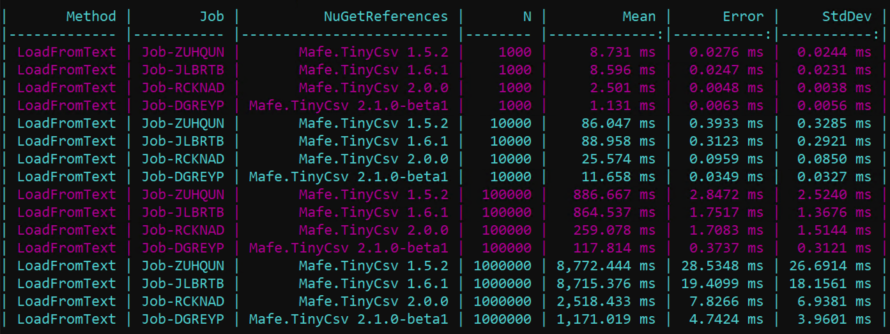

# Performance

## Compared with other libraries

The [competitive benchmark](https://github.com/fmazzant/TinyCsv/blob/master/benchmark/README.md#competitive-benchmark) reads and writes 100,000 rows of 8 typed columns
(`int`, `string`, `decimal`, `DateTime`, `bool`, with some quoted values) with TinyCsv, [CsvHelper](https://joshclose.github.io/CsvHelper/),
[Sylvan.Data.Csv](https://github.com/MarkPflug/Sylvan) and [Sep](https://github.com/nietras/Sep).

| Library | Read | Write |
|---|---:|---:|
| **TinyCsv** | **53.7 ms / 23.7 MB** | **36.6 ms / 2.2 MB** |
| CsvHelper | 119.1 ms / 53.2 MB | 80.7 ms / 25.2 MB |
| Sylvan | 28.3 ms / 23.8 MB | 38.5 ms / 0.05 MB |
| Sep | 53.8 ms / 23.7 MB (median 45.1 ms) | 45.9 ms / 0.02 MB |

TinyCsv and CsvHelper map the columns to the properties, while Sylvan and Sep are used with a hand written mapping.
Environment: BenchmarkDotNet 0.14.0, .NET 8.0.29, Windows Server 2019 (Hyper-V), Intel Xeon Platinum 8370C 2.80GHz.

## Compared with the previous versions

The [versions benchmark](https://github.com/fmazzant/TinyCsv/blob/master/benchmark/README.md#versions-benchmark) compares the last versions of TinyCsv with [BenchmarkDotNet](https://benchmarkdotnet.org/), reading and writing `N` rows of 7 columns.
Each cell is the mean time and the allocated memory.

### LoadFromText

| N | 2.1.0 | 2.2.2 | 3.0 |
|---:|---:|---:|---:|
| 100 | 0.072 ms / 119 KB | 0.106 ms / 195 KB | **0.065 ms / 94 KB** |
| 1,000 | 0.727 ms / 1.14 MB | 1.067 ms / 1.89 MB | **0.647 ms / 0.82 MB** |
| 10,000 | 8.39 ms / 11.40 MB | 14.62 ms / 18.88 MB | **7.42 ms / 8.13 MB** |
| 100,000 | 74.4 ms / 114.0 MB | 110.6 ms / 188.7 MB | **71.5 ms / 81.2 MB** |
| 1,000,000 | 772 ms / 1,140 MB | 1,099 ms / 1,887 MB | **679 ms / 812 MB** |

With 1,000,000 rows, 3.0 reads **38% faster** than 2.2.2 and allocates **57% less memory**.

### SaveToText

| N | 2.1.0 | 2.2.2 | 3.0 |
|---:|---:|---:|---:|
| 100 | 0.092 ms / 107 KB | 0.093 ms / 107 KB | 0.100 ms / 124 KB |
| 1,000 | 1.117 ms / 1.10 MB | 1.120 ms / 1.10 MB | 1.105 ms / 1.26 MB |
| 10,000 | 11.88 ms / 10.47 MB | 11.47 ms / 10.47 MB | 12.71 ms / 12.08 MB |
| 100,000 | 94.4 ms / 100.7 MB | 95.8 ms / 100.7 MB | 104.4 ms / 116.7 MB |
| 1,000,000 | 988 ms / 1,103 MB | 983 ms / 1,103 MB | 1,107 ms / 1,263 MB |

In 3.0, `Save` escapes the values as RFC 4180, so the saved file is always read back as it is.
The write is about 12% slower and allocates about 15% more memory than 2.2.2.

Environment: BenchmarkDotNet 0.13.12, .NET 8.0.29, Windows Server 2019 (Hyper-V), Intel Xeon Platinum 8370C 2.80GHz.
The 3.0 column was measured with the 3.0.0-rc1 package. The results of 3.3.0 will be added after its release.
The full report is in [benchmark/results](https://github.com/fmazzant/TinyCsv/blob/master/benchmark/results/TinyCsvLibraryBenchmark-report-github.md).

Previous results (1.5.2 - 2.1.0-beta1)

